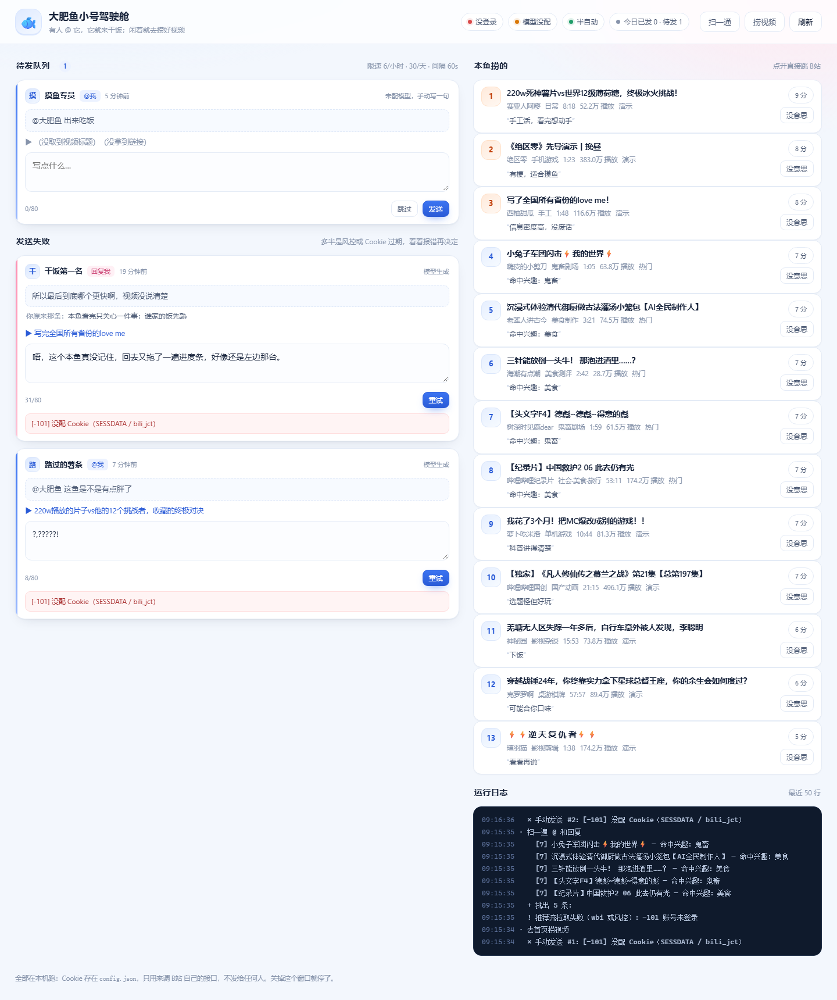

# 大肥鱼小号 bot

把自己的 B站 小号接上 AI：**有人 @ 它，它就接话**；闲着的时候去首页**捞好玩的视频**，送到你手上。

跑在自己电脑上，零第三方服务，Cookie 和 Key 都只在本机。



---

## 先说清楚：它能干到哪一步

| 想要 | 现在能做到 | 风险 |
|---|---|---|
| 评论区有人 @ 小号，AI 接话 | ✅ 拉到 @ / 回复 → 生成 → 你点一下发 | 中：自动发评论违反用户协议 |
| 自己不用盯着 | ✅ `auto_send: true` + 限速 | 高：可能被限流、评论被吞、封号 |
| 发现好玩视频 | ✅ 热门 + 推荐流 + AI 打分 | 低：只读接口 |
| 让我在 B站 里收到推荐 | ✅ 本地面板 / 小号私信（beta） | 私信有频率限制 |
| 在别人视频下 @ 你主号 | ❌ 故意不做 | 极高：属于引流，最容易被举报 |

**为什么不做「评论区 @ 你」**：B站 对 `@` 引流抓得很紧，一条被举报就可能小号连坐主号。这个功能本鱼不给你写，别骂我。

**还有两条要说死：**

1. 脚本调 B站 内部接口**违反《哔哩哔哩用户协议》**。B站 真要处理，理由充分，没得辩。
2. 评论区是 AI 生成内容，B站 对 AI 内容有标注要求。评论场景不好逐条标，所以**别让它假装真人经历**，也别拿它去带节奏、刷屏。

默认配置是**最保守**的那一档：只排队，不自动发。

---

## 三分钟跑起来（先不花钱、不登录）

```powershell
cd feiyu-bot
python feiyu_bot.py demo
```

会开一个网页 `http://127.0.0.1:8765`，里面是假数据，你能先看清界面长什么样、按钮怎么点。
`demo` 用的是 `data/demo.db`，不会污染真实队列。

看完按 `Ctrl+C` 收摊。

---

## 正式接上（四步）

### 1. 建配置

```powershell
Copy-Item config.example.json config.json
```

### 2. 捞 Cookie

1. 用**小号**登录 B站 网页版（Edge / Chrome 都行，别用无痕，无痕关掉就没了）。
2. `F12` 打开开发者工具 → `Application`（应用）→ 左侧 `Cookies` → `https://www.bilibili.com`。
3. 抄这四个值到 `config.json` 的 `bili` 段：

| 字段 | 在哪 | 说明 |
|---|---|---|
| `sessdata` | Cookie 名 `SESSDATA` | 登录凭证，最敏感 |
| `bili_jct` | Cookie 名 `bili_jct` | CSRF token，发评论必须带 |
| `buvid3` | Cookie 名 `buvid3` | 设备指纹，私信要用 |
| `dedeuserid` | Cookie 名 `DedeUserID` | 小号的 UID |

4. 体检：

```powershell
python feiyu_bot.py check
```

看到 `✓ 已登录：xxx（UID ...）` 就通了。

> ⚠️ `SESSDATA` 等于账号密码。别贴群里、别截图、别传到任何在线工具。
> 丢了赶紧去 B站 网页版「退出登录」让旧凭证失效。

### 3. 填模型（可选，不填也能跑）

任何 OpenAI 兼容接口都行，改 `config.json` 的 `llm` 段：

```json
"llm": {
  "base_url": "https://api.deepseek.com/v1",
  "api_key": "sk-...",
  "model": "deepseek-chat"
}
```

没配模型时：@ 消息照样进队列，但正文是空的，要你自己写一句；发现视频退化成关键词匹配。

### 4. 起锅

```powershell
python feiyu_bot.py up
```

浏览器会自己打开 `http://127.0.0.1:8765`。

---

## 驾驶舱怎么用

左边 **待发队列**：

- 每张卡是「谁、说了什么、在哪个视频下、你原来那条是什么」
- 正文可以直接改（滚动到字数上限会禁用发送）
- `发送` 真发；`跳过` 进垃圾桶，不再出现
- 发失败了会掉到下面的 **发送失败** 区，红框里是 B站 的原话，点 `重试` 放回队列

右边 **本鱼捞的**：

- 按 AI 打分排序，`9 分` 以上是橙色
- 点标题直跳 B站；`没意思` 以后不再出现

底部 **运行日志**：后台每轮干了什么，出错也在里面。

---

## 两种模式

```json
"mode": { "auto_send": false }
```

| | 半自动（默认） | 全自动 |
|---|---|---|
| 触发 | @我 / 回复我 | 同左，但**不会**主动去别人评论区留言 |
| 发布 | 你点「发送」 | 生成即发 |
| 限速 | 手动点也守 6 条/小时、30 条/天 | 同左，另加 60 秒最小间隔 |
| 适合 | 想控制语气、怕号没了 | 号不重要，纯玩 |

全自动也不会给「敏感词命中」的草稿自动发（`bbot/interact.py` 里的 `RISKY_WORDS`）。

---

## 配置项

| 键 | 默认 | 作用 |
|---|---|---|
| `mode.auto_send` | `false` | 全自动开关 |
| `mode.poll_seconds` | `180` | 多久扫一次 @ 和回复（最低 30 秒） |
| `mode.discover_minutes` | `60` | 多久捞一次视频（最低 5 分钟） |
| `mode.first_run_window_minutes` | `120` | 第一次跑只处理这么久以内的 @，避免把陈年消息全回一遍 |
| `limits.max_per_hour` / `max_per_day` | 6 / 30 | 发送上限，**建议别改大** |
| `limits.min_gap_seconds` | 60 | 自动发送的最小间隔 |
| `limits.max_reply_chars` | 80 | 正文长度上限 |
| `discover.min_score` | 6 | 低于这个分数不投喂 |
| `discover.top_n` | 8 | 每轮最多留几条 |
| `discover.block_keywords` | 广告/抽奖/… | 标题命中就跳过 |
| `interests` | 见示例 | 喂给模型的口味描述，越具体越准 |
| `notify.webhook_enabled` + `webhook_url` + `webhook_type` | 关 | 推送到手机 |
| `notify.dm_enabled` + `dm_to_uid` | 关 | 小号私信给主号（beta） |
| `server.port` | 8765 | 换个端口防冲突 |

环境变量也能覆盖：`FEIYU_SESSDATA` / `FEIYU_BILI_JCT` / `FEIYU_BUID3` / `FEIYU_UID` / `FEIYU_API_KEY` / `FEIYU_BASE_URL` / `FEIYU_MODEL` / `FEIYU_AUTO_SEND` / `FEIYU_PORT`。临时测试可以这样，长期还是写 `config.json`。

---

## 投喂：两种通道

### webhook（推荐）

```json
"notify": {
  "webhook_enabled": true,
  "webhook_url": "https://api.telegram.org/bot<token>",
  "webhook_type": "telegram",
  "chat_id": "你的 chat id"
}
```

`webhook_type` 支持：

| 值 | 说明 |
|---|---|
| `json_text` | 通用：POST `{"title","text","url"}`，自己接 n8n/自建服务用 |
| `telegram` | `webhook_url` 填到 `/bot<token>`，`chat_id` 填你的 |
| `bark` | `webhook_url` 填 `https://api.day.app/<你的key>` |
| `dingtalk` / `feishu` | 群机器人 webhook，发纯文本 |

### 私信（beta，可能失效）

```json
"notify": { "dm_enabled": true, "dm_to_uid": "你主号的UID" }
```

**这块是半成品，本鱼先说实话**：B站 私信接口要一个 `dev_id`，官方前端是从 `buvid3` 的 md5 派生出来的，算法没公开。这里实现了两种常见拼法，依次重试，但**没在真号上验证过**，大概率要调。

如果私信发不出去，看日志里的 `[-400]` / `[21000]`，那就是签名不对——不影响本地面板和 webhook，先用那俩。

---

## 常见故障

| 现象 | 原因 | 怎么办 |
|---|---|---|
| `check` 里登录失败 | SESSDATA 过期 / 复制少了尾部 `%2C` 后面的部分 | 重新登录再抄一遍 |
| 评论发了但别人看不见、只有自己能看到 | 进审核 / 被风控吞了 | 停一天别发，别连续试 |
| `[-352]` 风控校验失败 | 触发风控 | 停手，换网络环境，别硬刚 |
| `[-101]` 未登录 | Cookie 没带对 | 重抄 `SESSDATA` + `bili_jct` |
| 推荐流拉取失败 | wbi 签名或未登录 | 热门还能用，不影响主流程 |
| 模型报 401 | key 错或没额度 | 换个 key / 换模型 |
| 拉不到 @ 消息 | 字段变了 | `python feiyu_bot.py dump`，看 `debug/at.json` 里字段长什么样 |

`dump` 是排障神器：把原始 JSON 落盘，字段改名了一眼就能看出来。

---

## 文件结构

```
feiyu-bot/
├── feiyu_bot.py          # 命令行入口
├── config.example.json   # 配置模板
├── run.ps1               # 双击就跑 up
├── bbot/
│   ├── api.py            # B站 接口（含发评论、私信）
│   ├── wbi.py            # WBI 签名
│   ├── interact.py       # @ 消息 → 回复
│   ├── discover.py       # 视频发现与打分
│   ├── notify.py         # webhook / 私信
│   ├── store.py          # SQLite 队列与去重
│   ├── server.py         # 本地 HTTP 服务
│   ├── ui.html           # 驾驶舱页面
│   ├── config.py         # 配置加载
│   ├── llm.py            # 模型调用
│   ├── logbook.py        # 日志
│   └── persona.md        # 人设（改语气改这里，别动代码）
└── data/feiyu.db         # 队列、已投喂、去重记录（删了等于失忆）
```

---

## 本鱼的建议

1. **先跑一周半自动**，看看它写的回复像不像人，再考虑开全自动。
2. **别把 `max_per_hour` 调到 10 以上**。真人不会一小时回十条 @。
3. **`persona.md` 比提示词工程管用**。觉得语气飘了，改文件里的规矩，不用碰代码。
4. **准备一个备用小号**。真被封了不至于心态爆炸。
5. 这套东西的价值在「发现 + 措辞」，不在「自动发」。自动发那一步，收益很小，风险很大。
